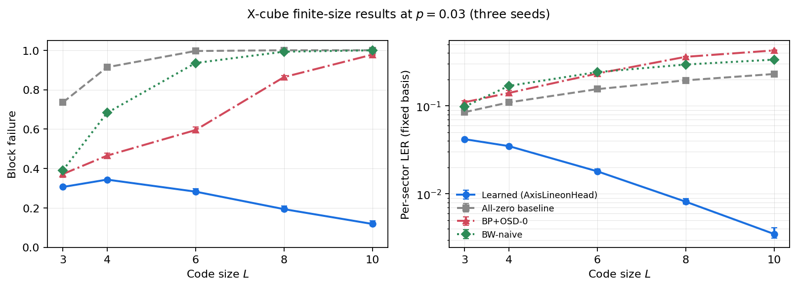

# Geometry-Aware Learned Syndrome Recovery

This repository contains a four-paper research program on learned recovery from
syndrome constraints. The work connects classical binary syndrome source coding,
3D voxel reconstruction, axial-parity codespaces, and topological quantum error
correction (QEC).

The work began with a communication question: how little instance-specific
information must a sender transmit when the receiver already has a useful
model of the source? A syndrome acts as an index into a set of compatible
signals, and the shared prior ranks or samples reconstructions within that set.
It does not uniquely identify every possible source. Exact recovery, low
distortion, and a plausible conditional sample are different objectives.

The classical experiments study voxel reconstruction with spectral and coarse
side information as well as syndrome bits; syndrome-only reconstruction remains
the motivating goal. The quantum experiments instead infer logical error
classes under a noise prior. A plausible replacement for an unknown quantum
state is not successful quantum recovery. The common research question is how
constraint geometry, learned priors, and computational budgets affect inference.



## Executive Summary

Across four companion papers, we study how algebraic constraints and learned
neural proposals interact on 3D lattices.

**Headline result.** We introduce a structure-aware neural decoder for the
X-cube fracton code using an `AxisLineonHead` line-aggregation layer. In the
retained scaling experiment, learned per-sector logical error rate improves from
`L=3` through `L=10` at `p=0.03`, while the implemented baselines do not show
the same trend. Whole-block failure improves from `L=4` onward at `p=0.03`,
but worsens with size at `p=0.05`. Models are trained separately at each `(L,p)`;
these are finite-size measurements, not a threshold or cross-size-transfer result.

**Related questions.** The other three papers examine different parts of
prior-conditioned recovery; they are not proofs of a common physical theory:

1. **Constraint locality.** In 3D voxel compression, high-weight global parity
   projections can degrade strong learned spatial proposals. Local overlapping
   surface checks and targeted belief propagation improve the tested proposals,
   with additional syndrome bits. Matched-rate and matched-solver comparisons
   are needed to isolate locality.
2. **Codespace structure.** We prove that the corrected axial-parity voxel codec
   has codespace `image(d_x d_y d_z)`, with an exact redundancy in its potential
   representation. This algebraic identity does not by itself establish
   equivalence to a physical fracton gauge theory or the X-cube phase.
3. **Surface-code capacity boundaries.** We map where pure spatial 3D
   convolutional decoders beat paired MWPM in the studied surface-code setting,
   and where the same architectural family runs into data/capacity boundaries.

The shared question is:

> A syndrome defines compatible possibilities, and a prior supplies a preference
> among them. How do the constraint geometry and the decoder's architecture
> affect the accuracy and cost of that inference?

## How to Read the Series

The papers can be read in two complementary orders.

For the shortest path to the main result, start with the X-cube paper and then
read the supporting papers as foundations:

| Role | Paper | Setting | Core Lesson |
|---|---|---|---|
| Headline result | [`fracton.pdf`](papers/fracton.pdf) | X-cube fracton QEC | A line-aware neural readout can scale favorably with code size where generic baselines struggle. |
| Classical diagnostic | [`compression.pdf`](papers/compression.pdf) | 3D voxel occupancy grids | Local constraint structure improves learned proposals; global projections can erase useful geometry. |
| Algebraic foundation | [`gauge.pdf`](papers/gauge.pdf) | Axial parity codes | A constructive codespace parameterization does not automatically yield a useful neural architecture. |
| Positive-control QEC study | [`qec.pdf`](papers/qec.pdf) | Surface-code QEC | Right-sized spatial decoders can beat MWPM in some regimes, but the capacity boundary is visible and measurable. |

For the original conceptual sequence, start with classical reconstruction
(compression), then the axial codespace theorem (gauge), surface-code resource
budgets (QEC), and X-cube logical decoding (fracton). This follows the question
from a shared source prior and compact transmitted evidence to quantum recovery
with a different success criterion.

Together, the papers investigate learned syndrome recovery through distinct
algebraic and empirical results. They motivate geometry-aware architectures
while keeping feasibility, statistical preference, and successful recovery
separate.

## Claims and Non-Claims

### What we claim

- A geometry-matched learned decoder can exploit syndrome structure that generic
  algebraic baselines miss in the studied regimes.
- For the X-cube code-capacity X-noise benchmark, the `AxisLineonHead` decoder
  improves per-sector logical error rate with code size through `L=10` at
  `p=0.03` in the retained experiments.
- In the voxel-compression setting, local overlapping surface constraints help a
  strong learned proposal, while hard high-weight algebraic projection can
  damage it.
- The axial-parity voxel codec has a constructive algebraic codespace:
  `image(d_x d_y d_z)` with rank `3n^2 - 3n + 1` for the corresponding parity
  checks.
- Pure spatial 3D convolutional surface-code decoders have measurable
  per-distance capacity knees and visible data/capacity boundaries.

### What we do not claim

- We do not demonstrate a passive or self-correcting quantum memory.
- We do not demonstrate syndrome-only or lossless voxel reconstruction.
- We do not establish a physical equivalence between the classical axial code
  and a particular fracton gauge theory.
- We do not claim a production compression codec or state-of-the-art learned
  voxel/point-cloud compression system.
- We do not claim state-of-the-art surface-code decoding or dominance over
  hybrid/neural-MWPM methods.
- We do not claim to benchmark the fully tuned Brown-Williamson X-cube decoder;
  the paper reports a clearly labeled `BW-naive` baseline.
- We do not claim asymptotic optimality or zero-shot cross-size transfer. The
  retained X-cube models are trained separately per code size.

## Papers and Pipelines

### 1. Structure-Aware Neural Decoding for the X-Cube Fracton Code

- Paper: [`papers/fracton.pdf`](papers/fracton.pdf)
- Code: [`fracton_xcube/`](fracton_xcube/)
- Tutorial: [`papers/tutorials/fracton.html`](papers/tutorials/fracton.html)
- Example: [`papers/examples/fracton_examples.html`](papers/examples/fracton_examples.html)

Core idea: the X-cube code has subdimensional lineon structure. The decoder uses
an `AxisLineonHead` to aggregate evidence along the logical line geometry rather
than flattening the problem into a generic 3D classifier.

```bash
cd fracton_xcube
python3 reproduce_xcube_results.py --verify-only --Ls 2 3 --out /tmp/xcube_verify.json
```

The learned-decoder smoke run is more expensive because it trains a small model:

```bash
cd fracton_xcube
python3 reproduce_xcube_results.py --smoke --skip-bw --out /tmp/xcube_smoke.json
```

### 2. Sizing and Capacity Boundaries for Surface-Code QEC

- Paper: [`papers/qec.pdf`](papers/qec.pdf)
- Code: [`surface_code_qec/`](surface_code_qec/)
- Tutorial: [`papers/tutorials/qec.html`](papers/tutorials/qec.html)

Core idea: pure spatial 3D convolutional decoders have measurable capacity
knees. The retained multi-seed results compare classic and LC0-style residual
blocks against paired MWPM across distances and physical error rates.

```bash
cd surface_code_qec
python3 reproduce_qec_results.py --results-dir data/qec_clean_knee_multiseed_json \
  --distances 3,5,7,9,11 --seeds 42,43,44 \
  --out /tmp/qec_reproduction.json
```

### 3. Gauge Structure and Architectural Inductive Bias

- Paper: [`papers/gauge.pdf`](papers/gauge.pdf)
- Code: [`fracton_xcube/src/gauge_paper/`](fracton_xcube/src/gauge_paper/)
- Tutorial: [`papers/tutorials/gauge.html`](papers/tutorials/gauge.html)

Core idea: the corrected axial-parity codec has an exact potential
parameterization, but the tested fixed-output implementation underperforms
alternative priors on validation data. Broader architectural conclusions need
matched-capacity, multi-seed tests.

```bash
cd fracton_xcube
python3 verify_fracton_theorem.py
```

### 4. Constraint Locality in Learned Syndrome Decoding

- Paper: [`papers/compression.pdf`](papers/compression.pdf)
- Code: [`voxel_compression/`](voxel_compression/)
- Tutorial: [`papers/tutorials/compression.html`](papers/tutorials/compression.html)

Core idea: the useful constraints are local, overlapping, and content-aware.
Large global row checks are algebraically valid but weak for local neural
reconstruction.

```bash
cd voxel_compression
python3 reproduce_results.py --baselines-only --n-samples 1 \
  --out /tmp/voxel_reproduction.json
```

Full compression reproduction requires external ShapeNet validation data and
trained checkpoints; the checked-in JSONs are the paper artifacts.

## Repository Layout

```text
papers/
  fracton.pdf
  qec.pdf
  gauge.pdf
  compression.pdf
  tutorials/
  examples/
  figures/

fracton_xcube/
  reproduce_xcube_results.py
  make_scaling_figure.py
  verify_fracton_theorem.py
  src/
  data/

surface_code_qec/
  reproduce_qec_results.py
  src/
  data/

voxel_compression/
  reproduce_results.py
  stratify_compression_results.py
  configs/
  src/
  data/
```

## Reproducibility

To rebuild the four manuscript PDFs from the checked-in TeX and figures, install
a TeX distribution with `latexmk` and Latin Modern fonts, then run
`bash papers/build.sh` from the repository root. This builds the documents;
it does not rerun the experiments.

Install Python dependencies with:

```bash
python3 -m pip install -r requirements.txt
```

The top-level command map is [`REPRODUCIBILITY.md`](REPRODUCIBILITY.md). Each
module has its own compact reproducibility guide:

- [`fracton_xcube/REPRODUCIBILITY.md`](fracton_xcube/REPRODUCIBILITY.md)
- [`fracton_xcube/GAUGE_REPRODUCIBILITY.md`](fracton_xcube/GAUGE_REPRODUCIBILITY.md)
- [`surface_code_qec/REPRODUCIBILITY.md`](surface_code_qec/REPRODUCIBILITY.md)
- [`voxel_compression/REPRODUCIBILITY.md`](voxel_compression/REPRODUCIBILITY.md)

### Reproducibility levels

- **Smoke-test reproducible from source.** Lightweight verification and smoke
  commands are included for the X-cube, gauge, QEC, and compression modules.
- **Artifact reproducible from checked-in JSON.** The paper figures and retained
  numerical summaries are backed by canonical result JSONs in the repository.
- **Full experiment reproduction may require external assets.** Large trained
  checkpoints and external datasets are not committed. Full ShapeNet-based
  compression reproduction and some large training sweeps require the external
  data/checkpoints described in the per-module reproducibility guides.

The release repository contains source code, preprint PDFs, tutorials, selected
figures, canonical result JSONs, and exact commands for the retained paper
artifacts.

## Why This Matters

This program sits at the intersection of scientific machine learning, error
correcting codes, quantum fault tolerance, and 3D geometric inference. The
technical theme is deliberately narrow and reusable: when recovery is defined by
algebraic constraints, the winning architecture is often the one that respects
the geometry of the constraint system without mistaking algebraic exactness for
a useful learning bias.

